# N20 · Visual directions (#35)

Three style frames for **the projector during play** and **the phone console**. Same layout, same live game, different looks. Exploration only: nothing here changes the product UI. Alex picks a direction (or rejects them all). After that, implementation gets split into token and per-screen issues.

## How these were made

`scripts/style-frames.ts` plays a real, seeded game: 6 teams for the normal board, 12 teams for compact mode, with bots buying in the markets. It freezes the projector and phone screens mid-mission, then renders that **one frozen DOM** under each stylesheet in `css/`. So every difference you see comes from CSS. None of the frames is a mock drawn from scratch, and each direction is a measured diff against today's `styles.css`.

```bash
npm run build && node --import tsx scripts/style-frames.ts   # rewrites frames/*.jpg and axe.json
```

Every frame also runs through axe (WCAG 2.1 A/AA, the same tags as `tests/e2e/a11y.spec.ts`). **All 20 frames are clean** (`axe.json`). Reduced motion: none of the directions adds motion. Frames are rendered with `reducedMotion: 'reduce'`.

## Today, and what any direction should fix

| Projector, 6 teams | Projector, 12 teams (compact) | Phone, Vet |
| --- | --- | --- |
| 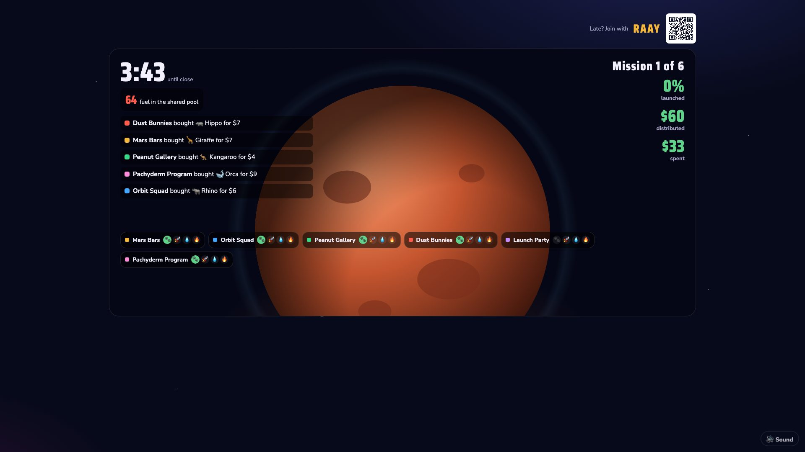 | 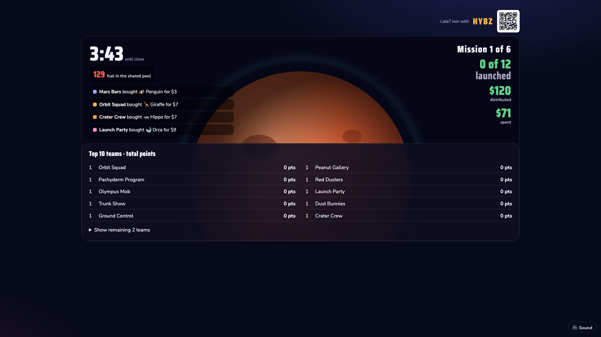 | 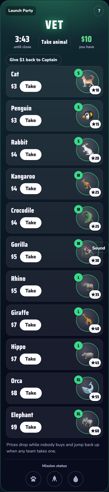 |

The identity is good: night sky, terraforming Mars, one colour per role, Saira Condensed numerals. The phone console is in good shape. The projector is where value is lost:

1. **The board uses ~1400×640 of a 1920×1080 frame.** On a video call the shared screen is then shrunk into a tile, so the waste is compounded.
2. **What the room most wants to read is the smallest thing on screen.** Team chips are 14px text with 20px status icons. Feed lines are 15px. The clock is huge, but "who has launched" is tiny.
3. **The planet sits behind the feed and the chips**, fighting them for contrast.

`css/room-scale.css` fixes those without changing the look: full-width board, 22–24px minimum for anything a player reads, 36px status icons, a 104px clock. It is applied under **every** direction below, because it's the biggest win whatever Alex picks.

## The three directions

### A · Mission Control: evolve what's there

Same night sky, roles and fonts, but flat and opaque instead of glassy. The planet steps back (50% opacity) so the data leads. Amber marks "live" (the clock). Hairline panels, no glows or `backdrop-filter`.

| Projector | Compact | Phone |
| --- | --- | --- |
| 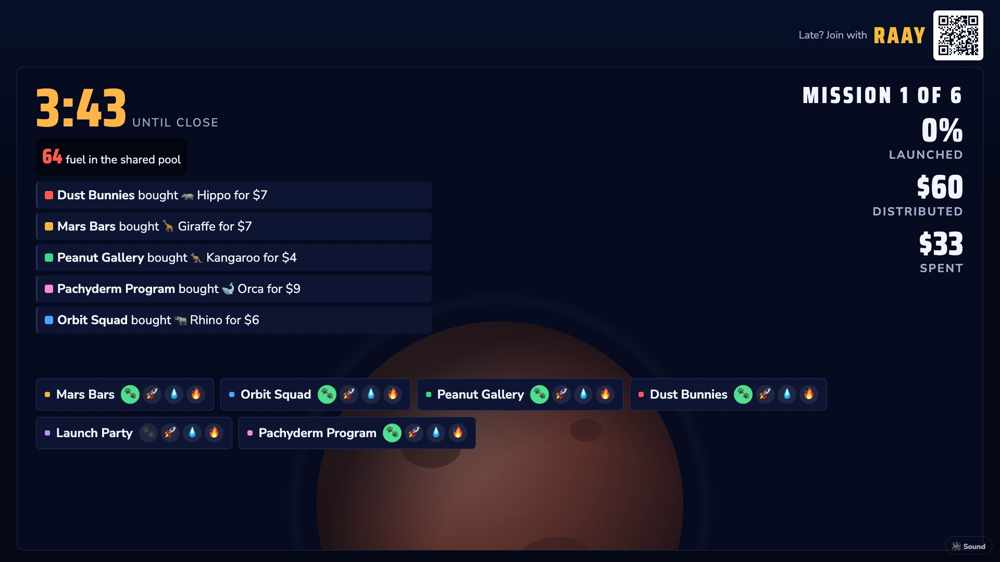 | 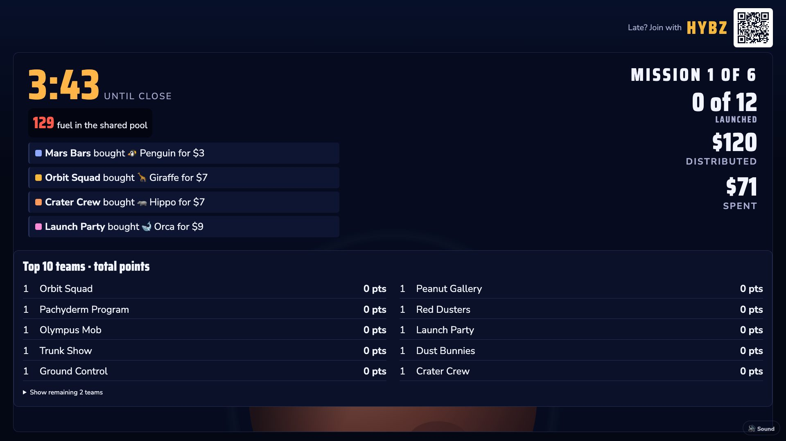 | 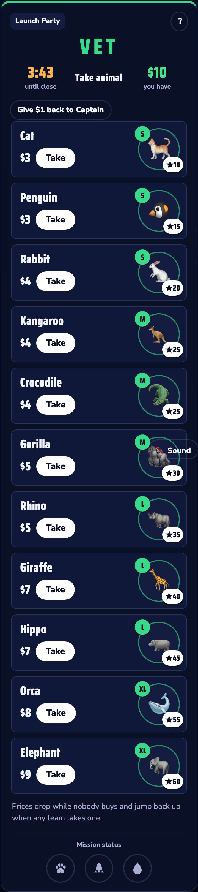 |

### B · Mars Daylight: a light theme

Dusty sand and terracotta with dark ink. White mission cards on the phone. The planet rises from a warm horizon. Role colours are darkened to hold AA on light cards.

| Projector | Compact | Phone |
| --- | --- | --- |
| 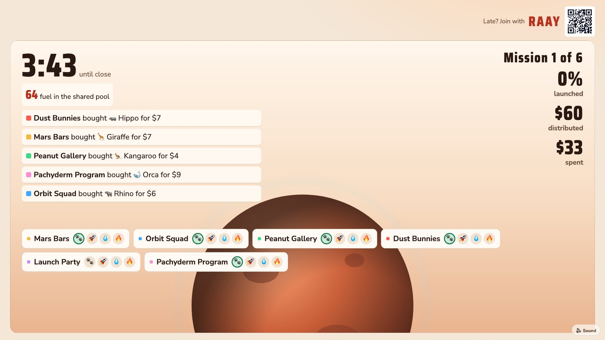 | 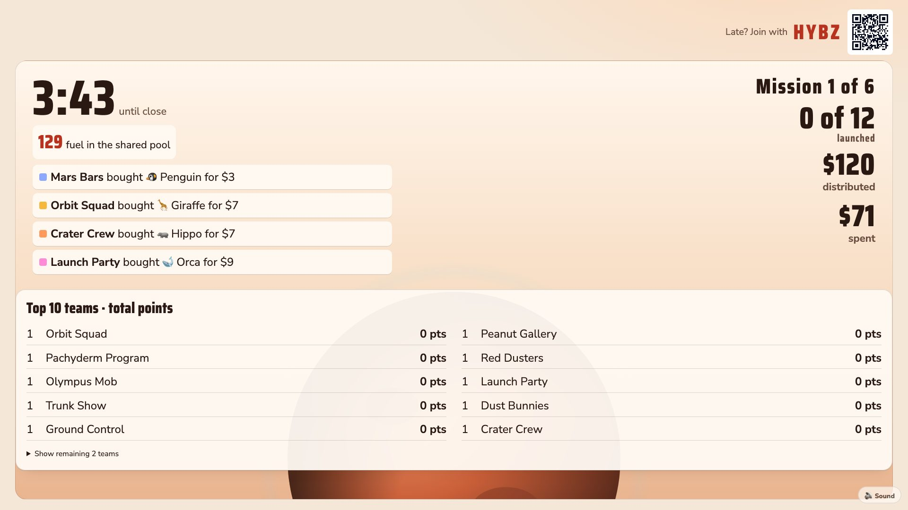 | 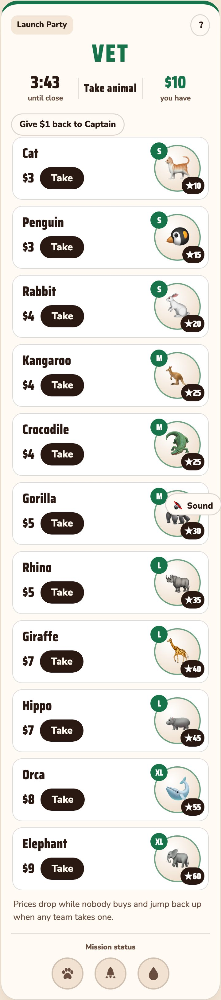 |

### C · Cosmic Cartoon: lean into the party game

Flat saturated violet, chunky ink outlines, hard "sticker" shadows (no blur), all-caps headings, and a role-coloured header slab on the phone. The most personality, and the closest to a game-show feel.

| Projector | Compact | Phone |
| --- | --- | --- |
| 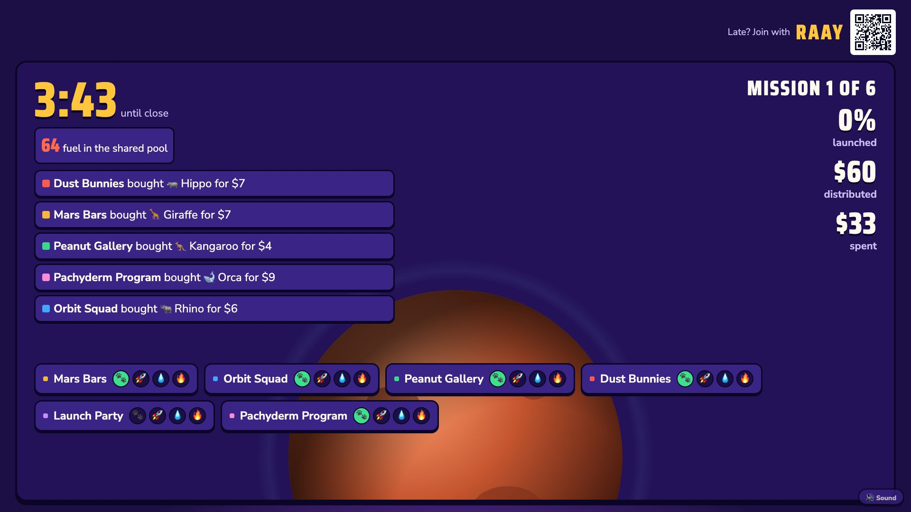 | 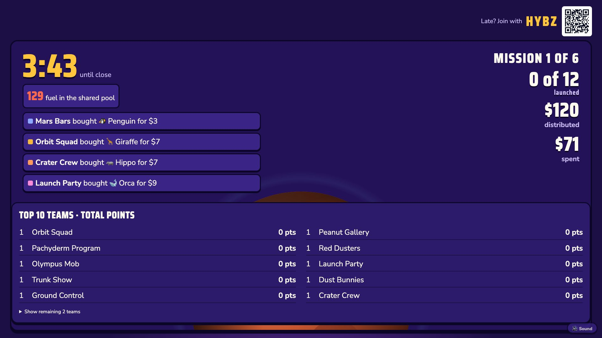 | 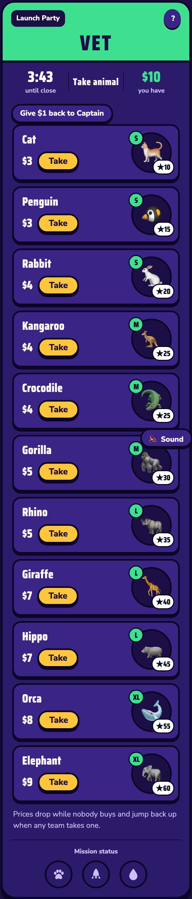 |

The Pilot and Engineer consoles for every direction are in `frames/` too.

## Tradeoffs

| | A · Mission Control | B · Mars Daylight | C · Cosmic Cartoon |
| --- | --- | --- | --- |
| Back-of-room / video-tile readability | Good (dark + room scale) | Best in a **lit room on a real projector**; no better than A over a video call | Good; thick outlines survive video compression |
| Keeps today's identity | Yes | No: day instead of night | Partly: same planet, new drawing style |
| Size of the change | Smallest: ~95 lines, mostly tokens | Largest: ~175 lines. All 55 hard-coded colours in `styles.css` must move to tokens first, or a light theme leaks dark fragments (it did here until each was overridden) | Medium: ~135 lines, but touches how every component is drawn (borders, shadows) |
| Phone performance on cell data | Best: removes blur, glows, extra gradients | Good: no blur | Good: hard shadows are cheap; no blur |
| Compact mode (>10 teams) | Works | Works | Works |
| axe (WCAG 2.1 AA) | Clean | Clean, but role colours had to be darkened, so AA needs watching | Clean |
| Risk | Low | Medium: report screens, landing page and lobby all need a light pass too | Medium: taste-dependent; outlines can feel busy on 11-item lists |

## Recommendation

**Ship `room-scale` first, then direction A, borrowing C's role-coloured phone header.**

- Most of the player-visible gain is room scale, not palette. It works with any look and is a small, testable projector-only change.
- A keeps what already works (the night sky, role colours, fonts) and is the cheapest and fastest on phones. Its diff is mostly tokens, which is exactly the "tokens first, then per screen" plan in the backlog.
- C's solid role-colour slab behind **VET / PILOT** is the single most "you are this role" moment in any frame. It's worth taking into A even if the rest of C isn't.
- B is the right call only if the game will mostly run **on a real projector in a lit room**. The product docs describe screen-sharing over a video call, where a dark theme loses nothing. Its cost (tokenising 55 colours and re-checking every screen) is better spent elsewhere unless that changes.

## Constraints any direction must keep

- **Projector:** readable from the back of the room and in a shrunken video-call tile. 22px minimum for player-facing text at 1080p. Compact mode above 10 teams keeps working.
- **`prefers-reduced-motion`:** directions add no motion. Anything new (glows, pulses) goes behind `@media (prefers-reduced-motion: no-preference)`, like the existing animations.
- **axe gate green:** `tests/e2e/a11y.spec.ts`, with no exceptions added.
- **Phones fast on cell data:** no new fonts, images or dependencies. Fonts stay bundled (strict CSP, nothing leaves the network). Prefer removing `backdrop-filter` and stacked gradients over adding effects.

## Noticed along the way (not visual direction, not fixed here)

- **The Sound button (N19) floats over phone content.** It's fixed bottom-right and covers part of an item's medal while you scroll a market list (visible in the phone frames). It's a small fix in any direction.
- **Compact-mode "Top 10" during mission 1 shows every team tied at "1 · 0 pts".** That's correct, but it uses the projector's biggest panel to say nothing yet. A content question for #38/N11, not styling.

## Follow-ups once a direction is chosen

These are proposals, not commitments. Issues get created after Alex decides (#35's acceptance criteria).

1. **Room scale on the projector:** port `css/room-scale.css` into `styles.css`. Independent of direction.
2. **Design tokens:** move hard-coded colours, radii and shadows in `styles.css` to `:root` tokens for the chosen direction (all of them, if B).
3. **Projector + market screens** in the chosen direction (Claude, per the backlog split).
4. **Phone consoles** in the chosen direction (Dex, per the backlog split).
5. **Sound button placement on phones**, so it never covers content.
